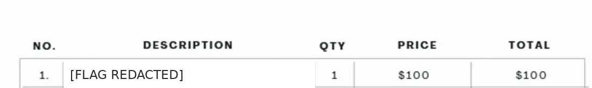

<div class="ctf-hero">

  <h1>Management Wants a Word</h1>

  <p>
    A Windows digital forensics investigation examining the relationship between local-account credential material, DPAPI-protected secrets, Chrome credential storage, and an encrypted VeraCrypt container. This write-up documents the artifact dependencies, investigation methodology, evidence limitations, and defensive implications observed in the TryHackMe training scenario.
  </p>

  <div class="ctf-badges">
    <span class="ctf-badge">TryHackMe</span>
    <span class="ctf-badge">Digital Forensics</span>
    <span class="ctf-badge">Windows</span>
    <span class="ctf-badge">Forensic Analysis</span>
  </div>

</div>

<p align="center">
  
</p>

## Navigation

<div class="ctf-toc">
<div class="ctf-toc-title">Documentation Map</div>

<ul>
  <li><a href="#mission-and-executive-summary">Mission and Executive Summary</a></li>
  <li><a href="#quick-overview">Quick Overview</a></li>
  <li><a href="#investigation-objectives">Investigation Objectives</a></li>
  <li><a href="#scope-and-evidence-limitations">Scope and Evidence Limitations</a></li>
  <li><a href="#investigation-methodology">Investigation Methodology</a></li>
  <li><a href="#evidence-acquisition-and-triage">Evidence Acquisition and Triage</a></li>
  <li><a href="#sam-and-system-registry-hive-analysis">SAM and SYSTEM Registry-Hive Analysis</a></li>
  <li><a href="#dpapi-master-key-analysis">DPAPI Master-Key Analysis</a></li>
  <li><a href="#chrome-encryption-key-recovery">Chrome Encryption-Key Recovery</a></li>
  <li><a href="#chrome-login-data-analysis">Chrome Login Data Analysis</a></li>
  <li><a href="#veracrypt-container-analysis">VeraCrypt Container Analysis</a></li>
  <li><a href="#evidence-correlation-and-attack-chain">Evidence Correlation and Attack Chain</a></li>
  <li><a href="#security-findings">Security Findings</a></li>
  <li><a href="#defensive-recommendations">Defensive Recommendations</a></li>
  <li><a href="#lessons-learned">Lessons Learned</a></li>
  <li><a href="#conclusion">Conclusion</a></li>
  <li><a href="#repository-information">Repository Information</a></li>
  <li><a href="#responsible-use">Responsible Use</a></li>
</ul>

</div>

---

## Mission and Executive Summary

The objective of the **Management Wants a Word** room on TryHackMe is to investigate a Windows forensic artifact chain and correlate credential-related evidence with a final artifact stored within an encrypted container.

The supplied source material identifies a Windows KAPE-style triage output associated with a user named `Vera`. The documented investigation connects local-account credential material to DPAPI-protected application data, Chrome's encryption metadata, the browser's login database, and a VeraCrypt container.

The investigation is presented as a forensic correlation exercise rather than a conventional live-host exploitation assessment.

<div class="key-finding">

<div class="key-finding-title">Primary Forensic Observation</div>

The documented artifact chain demonstrates how access to local-account credential material can contribute to recovering protected browser data. A recovered browser password may then provide access to a separate encrypted-storage boundary when the same password has been reused.

</div>

### Documented Artifact Dependency Chain

<div class="attack-chain">
  <div class="attack-step">SAM + SYSTEM</div>
  <div class="attack-arrow">→</div>
  <div class="attack-step">NT Hash</div>
  <div class="attack-arrow">→</div>
  <div class="attack-step">DPAPI Master Key</div>
  <div class="attack-arrow">→</div>
  <div class="attack-step">Chrome AES Key</div>
  <div class="attack-arrow">→</div>
  <div class="attack-step">Login Data</div>
  <div class="attack-arrow">→</div>
  <div class="attack-step">Recovered Password</div>
  <div class="attack-arrow">→</div>
  <div class="attack-step">VeraCrypt Container</div>
  <div class="attack-arrow">→</div>
  <div class="attack-step">Final Artifact</div>
</div>

This sequence summarizes the dependency chain described by the source material. It is not a claim that every intermediate step was independently captured in terminal output. The report explicitly distinguishes documented procedure from directly supplied visual evidence.

## Quick Overview

<div class="ctf-card-grid">

  <div class="ctf-card">
    <div class="ctf-card-title">Platform</div>
    <div class="ctf-card-value">TryHackMe</div>
  </div>

  <div class="ctf-card">
    <div class="ctf-card-title">Challenge</div>
    <div class="ctf-card-value">Management Wants a Word</div>
  </div>

  <div class="ctf-card">
    <div class="ctf-card-title">Operating System</div>
    <div class="ctf-card-value">Windows</div>
  </div>

  <div class="ctf-card">
    <div class="ctf-card-title">Assessment Type</div>
    <div class="ctf-card-value">Digital Forensic Artifact Analysis</div>
  </div>

  <div class="ctf-card">
    <div class="ctf-card-title">Primary Focus</div>
    <div class="ctf-card-value">Registry Hives, DPAPI, Chrome, VeraCrypt</div>
  </div>

  <div class="ctf-card">
    <div class="ctf-card-title">Environment</div>
    <div class="ctf-card-value">Authorized Training Lab</div>
  </div>

</div>

## Investigation Objectives

The investigation focuses on understanding and correlating the artifacts identified in the original walkthrough.

- Identify the relevant Windows triage locations and registry hives.
- Examine the documented relationship between SAM/SYSTEM-derived credential material and DPAPI-protected data.
- Locate the Chrome `Local State` file and identify its `os_crypt.encrypted_key` metadata.
- Understand the relationship between Chrome's encryption metadata and the `Login Data` database.
- Correlate the browser credential recovery stage with the VeraCrypt container.
- Document the final artifact and associated evidence without exposing the intentionally redacted challenge flag.
- Translate the observed artifact relationships into practical defensive recommendations.

## Scope and Evidence Limitations

This report is limited to the artifacts, procedures, paths, and screenshots contained in the supplied source documentation.

| Evidence category | Documentation status |
|---|---|
| Windows artifact locations | Paths documented in the source |
| SAM/SYSTEM analysis | Command and described methodology documented |
| Local account | `minivera` identified in the source |
| DPAPI master-key location | Path documented in the source |
| Chrome `Local State` | Path and relevant metadata documented |
| Chrome `Login Data` | Path and relevant database fields documented |
| VeraCrypt analysis | Example command sequence documented |
| Room overview | Screenshot supplied |
| Final artifact | Screenshot supplied with the flag redacted |
| Raw terminal output | No `secretsdump.py` terminal screenshot supplied |

**Evidence-handling principle:** A documented command is not equivalent to captured execution evidence. Where the source supplies methodology without corresponding terminal output, this report describes the procedure as documented methodology rather than presenting an invented execution result.

The source does not provide a target IP address, a complete operating-system build, exact recovered credential values, or a raw terminal transcript for each stage. These values are therefore not added to the report.

## Investigation Methodology

The investigation follows the artifact dependencies described in the source documentation.

| Phase | Artifact or activity | Investigative purpose |
|---|---|---|
| Triage | Windows user-profile and registry-hive locations | Identify relevant evidence sources |
| Registry analysis | `SAM` and `SYSTEM` | Examine local-account credential material |
| DPAPI analysis | User master-key directory | Investigate protected application secrets |
| Browser analysis | Chrome `Local State` | Identify encrypted-key metadata |
| Credential analysis | Chrome `Login Data` | Examine stored login records |
| Container analysis | VeraCrypt container | Correlate the recovered password with encrypted storage |
| Evidence correlation | Final artifact screenshot | Document the reported conclusion |

The methodology is dependency-driven. Each stage is relevant because it supplies context or credential material required by a subsequent stage.

---

## Evidence Acquisition and Triage

The supplied source identifies the following evidence locations:

```text
Users\Vera\
Windows\System32\config\
```

The user-profile directory is relevant because the investigation examines application data associated with `Vera`. The Windows configuration directory is relevant because it contains the registry hives identified by the source.

### Registry-Hive Evidence

The source identifies these files:

```text
SAM
SYSTEM
SECURITY
```

Their presence establishes the initial registry-hive analysis scope documented by the walkthrough.

The source specifically references `SAM` and `SYSTEM` for the local-account credential analysis stage. Although `SECURITY` is identified as part of the relevant directory, the supplied documentation does not describe a separate analysis result for that hive.

### Room Overview Evidence

<p align="center">
  
</p>

**Figure 1 —** Supplied TryHackMe room overview and challenge metadata.

The screenshot is retained at its original relative path. No additional screenshot or terminal output is implied by this figure.

---

## SAM and SYSTEM Registry-Hive Analysis

The Security Account Manager (SAM) and SYSTEM registry hives are the initial evidence sources identified for offline local-account credential analysis.

The source methodology references the following command:

```bash
python3 secretsdump.py -sam SAM -system SYSTEM LOCAL
```

### Command Purpose

The command invokes `secretsdump.py` to process the supplied SAM and SYSTEM hive files in a local-analysis context.

The documented purpose is to examine local-account credential material and identify the NT hash required by the subsequent DPAPI stage.

### Account Identified by the Source

The original walkthrough identifies the local account:

```text
minivera
```

The account's NT hash is described as the credential material needed for the next stage of the investigation.

### Evidence Limitation

No raw `secretsdump.py` terminal screenshot was supplied in the original documentation. Consequently, this report preserves the command and the stated outcome as source-described methodology; it does not invent command output, a hash value, or an additional credential.

### Forensic Significance

Offline registry-hive analysis can expose credential material without requiring an interactive login to the original Windows system. If an attacker obtains these sensitive files and can analyze them successfully, the confidentiality of local-account credentials may be affected.

The security impact depends on the available artifacts, account configuration, credential protections, and whether the material can be used to recover or authenticate as the relevant account.

---

## DPAPI Master-Key Analysis

The Windows Data Protection API (DPAPI) is relevant because Windows applications and components can use it to protect sensitive data with cryptographic keys associated with a user or system context.

The source identifies the user's DPAPI master-key directory as:

```text
Users\Vera\AppData\Roaming\Microsoft\Protect\<SID>\
```

`<SID>` is retained as a path placeholder from the source; the specific SID is not supplied.

### Documented Dependency

The walkthrough describes the following relationship:

```text
User Credential Material
          |
          v
DPAPI Master Key
          |
          v
Protected Application Secrets
```

The recovered account credential material is described as being used to analyze the DPAPI-protected master key.

### Referenced Methodology

The source references DonPAPI or a forensic Python implementation for this stage. It does not provide a specific DonPAPI command, package version, script path, or captured execution output.

For that reason, no tool invocation or successful decryption transcript is fabricated here.

### Forensic Significance

DPAPI-protected information may become accessible when an investigator or attacker obtains the necessary user-associated key material and satisfies the applicable protection requirements.

This makes the DPAPI master-key directory a significant artifact location during Windows endpoint investigations. Its presence alone does not establish that protected secrets have been decrypted; successful recovery depends on the relevant credentials and other required material.

---

## Chrome Encryption-Key Recovery

The Chrome artifact identified by the source is:

```text
Users\Vera\AppData\Local\Google\Chrome\User Data\Local State
```

The relevant metadata field is:

```text
os_crypt.encrypted_key
```

### Relationship to DPAPI

The source describes a dependency between the earlier DPAPI stage and Chrome's encryption metadata:

```text
DPAPI
  |
  v
Chrome Encryption Key
```

The encrypted-key metadata in Chrome's `Local State` file is part of the information needed to interpret encrypted browser credentials in the corresponding Chrome profile.

### Investigative Purpose

The purpose of examining `Local State` is to identify the protected encryption-key material associated with Chrome's stored data.

The subsequent browser-database analysis depends on obtaining the key material required to interpret the encrypted password values described by the challenge.

### Evidence Limitation

The original documentation does not provide a screenshot of the `Local State` file, a decoded key, a Python script, or a captured decryption result. This section therefore documents the identified artifact and its stated role without adding unsupported values.

### Forensic Significance

Browser profile artifacts may provide investigators with information about stored credentials and the protection mechanisms used to safeguard them. Access to a browser database does not, by itself, mean that its encrypted password values are immediately readable.

The relevant metadata, protection mechanism, and available key material must be assessed together.

---

## Chrome Login Data Analysis

The browser database identified by the source is:

```text
Users\Vera\AppData\Local\Google\Chrome\User Data\Default\Login Data
```

The original walkthrough identifies the `logins` table and the following fields:

```text
logins
 ├── origin_url
 ├── username_value
 └── password_value
```

### Artifact Interpretation

| Artifact or field | Documented role |
|---|---|
| `Login Data` | Chrome database containing login-related records |
| `logins` | Table identified by the source |
| `origin_url` | Origin associated with a stored login |
| `username_value` | Stored username field |
| `password_value` | Protected password-value field |

These field names are retained as documented in the original material.

### Credential Recovery Relationship

The source describes decrypting the protected password value using the recovered Chrome AES key.

The documented relationship is:

```text
Chrome Local State
        |
        v
Chrome Encryption Key
        |
        v
Login Data
        |
        v
Recovered Password
```

The recovered password is then correlated with the VeraCrypt container in the next phase.

### Forensic Significance

Chrome's `Local State` and `Login Data` artifacts must be interpreted together when investigating the protected login values described in this challenge. The database identifies login-related information, while the relevant encryption key is a dependency for interpreting protected password data.

The supplied source does not include an actual database query, a specific website URL, a recovered username/password pair, or a password-decryption transcript. No such values are invented in this report.

---

## VeraCrypt Container Analysis

The final documented analysis stage correlates the recovered browser password with a VeraCrypt container.

The original source provides the following example command sequence:

```bash
cryptsetup tcryptOpen <veracrypt_container_name> veracrypt_flag
mount /dev/mapper/veracrypt_flag /mnt/
```

### Command Purpose

**Container-opening command**

```bash
cryptsetup tcryptOpen <veracrypt_container_name> veracrypt_flag
```

The command requests that `cryptsetup` open a TrueCrypt-compatible encrypted container and expose it through the device-mapper name `veracrypt_flag`. The original placeholder `<veracrypt_container_name>` is preserved because the actual container filename was not supplied.

**Mount command**

```bash
mount /dev/mapper/veracrypt_flag /mnt/
```

The command attempts to mount the mapped device at `/mnt/` so that its contents can be inspected.

The source presents these commands as the example workflow for accessing the encrypted container. The report does not add a container filename, recovered password, command result, filesystem type, or successful mount transcript that was absent from the supplied material.

### Final Artifact Evidence

<p align="center">
  
</p>

**Figure 2 —** Final invoice artifact with the TryHackMe flag intentionally redacted.

The screenshot is the supplied visual evidence associated with the final stage. The challenge flag remains redacted in accordance with the original documentation.

### Forensic Significance

This stage demonstrates the importance of correlating credentials with their actual use across different protected resources.

A password discovered in one application may provide access to an unrelated encrypted container if the same secret has been reused. This is a credential-management failure: the two resources may use different technical protection mechanisms but are not meaningfully independent if both rely on the same compromised password.

---

## Evidence Correlation and Attack Chain

The source documentation connects the stages through the following artifact relationships:

<div class="attack-chain">
  <div class="attack-step">Windows Triage</div>
  <div class="attack-arrow">→</div>
  <div class="attack-step">SAM + SYSTEM</div>
  <div class="attack-arrow">→</div>
  <div class="attack-step">DPAPI Master Key</div>
  <div class="attack-arrow">→</div>
  <div class="attack-step">Chrome Local State</div>
  <div class="attack-arrow">→</div>
  <div class="attack-step">Chrome AES Key</div>
  <div class="attack-arrow">→</div>
  <div class="attack-step">Chrome Login Data</div>
  <div class="attack-arrow">→</div>
  <div class="attack-step">Recovered Password</div>
  <div class="attack-arrow">→</div>
  <div class="attack-step">VeraCrypt Container</div>
  <div class="attack-arrow">→</div>
  <div class="attack-step">Final Artifact</div>
</div>

### Correlation Summary

| Stage | Evidence or artifact | Relationship described by the source |
|---|---|---|
| 1 | Windows triage output | Supplies the user-profile and registry-hive context |
| 2 | `SAM` and `SYSTEM` | Used for offline local-account credential analysis |
| 3 | DPAPI master-key directory | Holds the identified user-associated master-key material |
| 4 | Chrome `Local State` | Contains `os_crypt.encrypted_key` metadata |
| 5 | Chrome `Login Data` | Contains the documented login-related fields |
| 6 | Recovered browser password | Used in the subsequent container-analysis stage |
| 7 | VeraCrypt container | Described as the encrypted resource opened in the walkthrough |
| 8 | Final artifact screenshot | Provides the supplied visual evidence for the concluding stage |

### Principal Security Observation: Credential Reuse

The key security observation is the reuse of a recovered password across different trust boundaries.

The browser credential and the VeraCrypt container represent separate resources. However, using the same password for both can allow a credential exposed through endpoint compromise to affect the confidentiality of the encrypted container as well.

The original source describes this as the central security implication. It does not provide the actual password or a raw execution transcript establishing every intermediate result, so those details remain intentionally unspecified.

---

## Security Findings

The following findings summarize the security implications described by the source material. They are qualitative observations, not formal penetration-test severity ratings. The original documentation does not provide CVSS scores or formally assigned severity levels.

| Finding | Evidence basis | Security significance |
|---|---|---|
| Offline SAM/SYSTEM access | Registry-hive paths and the documented `secretsdump.py` command | Obtained hive files can enable offline local-account credential analysis |
| DPAPI-dependent secrets | Documented master-key path and described methodology | Protected application data may be exposed if the necessary credential and key material become available |
| Browser-stored credentials | Chrome `Local State` and `Login Data` paths and fields | Browser-profile compromise can expose sensitive stored login information |
| Password reuse across boundaries | Source-described correlation between the recovered browser password and VeraCrypt | One compromised secret may undermine the confidentiality of another protected resource |
| Multiple artifacts in one user profile | Documented Windows profile, DPAPI and Chrome locations | A single endpoint acquisition may contain several interdependent evidence sources |

### Evidence Qualification

The finding descriptions reflect the risks demonstrated or discussed by the original walkthrough. They should not be interpreted as proof that every listed security weakness exists in all Windows systems, all Chrome installations, or every VeraCrypt deployment.

The impact in an actual environment would depend on the system configuration, encryption settings, credential reuse, access controls, and availability of the necessary evidence.

---

## Defensive Recommendations

The following controls are tied to the risks identified in the supplied walkthrough.

### Windows Endpoint Protection

**Finding:** Obtained registry hives may allow offline credential analysis.

**Risk:** An individual who acquires sensitive registry-hive material may be able to analyze local-account credential data outside the running operating system.

**Recommended controls:**

- Enable full-disk encryption to help protect data at rest when a device is powered off or accessed without the required unlocking material.
- Restrict local administrator privileges and access to sensitive system files.
- Protect endpoint backups and forensic acquisition locations with appropriate access controls.
- Monitor and investigate unauthorized access to sensitive registry-hive files and unusual attempts to acquire them.

Full-disk encryption is an important control for data at rest, but it does not eliminate the risk when a system is already unlocked or an attacker has sufficient access to obtain protected material.

### DPAPI-Protected Data

**Finding:** DPAPI-protected application secrets may be recoverable if the required credential and key material are compromised.

**Risk:** Access to a user's credential material and associated profile artifacts may expose protected application data.

**Recommended controls:**

- Protect user-profile data and endpoint backups from unauthorized access.
- Apply least-privilege access to accounts that can access sensitive profile and system locations.
- Investigate suspicious access to DPAPI master-key directories during endpoint compromise investigations.
- Assess potentially exposed application secrets when responding to a confirmed account or endpoint compromise.

The response should account for the specific application and data involved; the existence of DPAPI-protected artifacts alone does not establish that they have been decrypted.

### Browser Credential Storage

**Finding:** Chrome's login database contains protected credential values, and the associated encryption metadata is stored in the user profile.

**Risk:** An endpoint compromise may provide access to browser-stored credentials when the relevant protection requirements can be satisfied.

**Recommended controls:**

- Minimize storage of privileged, administrative, and other high-impact credentials in browsers.
- Use an appropriately managed password-management solution for credentials that require controlled storage and access.
- Restrict access to browser-profile data and protect endpoint backups containing those profiles.
- Review and rotate potentially exposed credentials following a confirmed endpoint compromise.

Credential rotation should target accounts whose secrets may have been exposed, with priority given to privileged and high-impact accounts.

### Credential Separation

**Finding:** A recovered browser password is described as being useful against a separate encrypted-storage boundary.

**Risk:** Password reuse can turn compromise of one resource into compromise of another resource.

**Recommended controls:**

- Use a unique, high-entropy password for each encrypted container and other security boundary.
- Do not reuse browser passwords, account passwords, or other application credentials for encrypted-storage containers.
- Store container credentials independently from the files and user profile they protect.
- Rotate affected credentials when exposure is suspected or confirmed.

This recommendation directly addresses the cross-boundary credential-reuse issue documented in the walkthrough.

### Encrypted-Container Security

**Finding:** The source correlates a recovered password with a VeraCrypt container.

**Risk:** The practical protection offered by encryption can be undermined if its password is exposed elsewhere or reused.

**Recommended controls:**

- Use a unique, high-entropy container password.
- Store the container password independently of the browser profile and other protected files.
- Limit access to the container and its backup copies.
- Reassess the container's password if the associated endpoint or a related credential is compromised.

Encryption strength alone cannot compensate for a password that has already been exposed through another resource.

---

## Lessons Learned

### 1. Follow Artifact Dependencies

Forensic artifacts are often interdependent. The registry-hive analysis, DPAPI master-key investigation, Chrome encryption metadata, and browser login database are related steps in the source-described workflow.

Understanding these dependencies helps investigators avoid treating each file as an isolated source of evidence.

### 2. Separate Evidence From Methodology

A command listed in a walkthrough explains a procedure, but it does not prove that the command produced a particular result.

The absence of a raw `secretsdump.py` screenshot in the source is an important reporting limitation. Preserving that distinction makes the documentation more defensible and easier for another analyst to review.

### 3. Interpret Chrome Artifacts Together

The `Local State` file and `Login Data` database serve different roles in the documented credential-recovery chain.

The database contains login-related records, while the encryption metadata is relevant to interpreting protected password values. Examining either artifact in isolation may provide an incomplete view of the available evidence.

### 4. Treat DPAPI as a Key Dependency

DPAPI-protected artifacts must be interpreted in the context of the associated user and the necessary credential or key material.

Finding a master-key file does not by itself establish that the protected data has been recovered. Reports should document the available files, the procedure used, and the evidence supporting any recovery claim.

### 5. Recognize Cross-Boundary Credential Reuse

Credentials recovered from one application may affect the confidentiality of another resource when the same password has been reused.

Unique credentials reduce this dependency and help preserve separation between otherwise independent security controls.

### 6. Preserve Evidence Provenance

A professional forensic report should identify which details come from source documentation, which are directly visible in screenshots, and which results have not been independently captured.

This approach improves technical accuracy, enables reproducibility, and avoids overstating the certainty of an investigation.

---

## Conclusion

The **Management Wants a Word** TryHackMe room documents a Windows forensic artifact chain connecting registry-hive analysis, DPAPI-protected master-key material, Chrome's encryption metadata, stored browser credentials, and a VeraCrypt container.

The central security lesson is the risk created when credential exposure crosses otherwise separate protection boundaries. If a password recovered from browser data is reused for an encrypted container, compromise of the browser credential can also put the container's confidentiality at risk.

The investigation additionally demonstrates the importance of evidence-driven documentation. Artifact paths, commands, screenshots, and source-described results have been preserved, while missing execution transcripts and intentionally redacted secrets remain unspecified.

The final artifact is represented by the supplied screenshot, and the TryHackMe challenge flag remains redacted. This write-up focuses on forensic methodology, artifact relationships, evidence limitations, and practical defensive implications.

---

## Repository Information

| Project | Value |
|---|---|
| Repository | `Management-Wants-a-Word-TryHackMe-Walkthrough` |
| Author | Anurag Revankar |
| Category | Digital Forensics |
| Platform | TryHackMe |
| Environment | Authorized Training Lab |

## Responsible Use

> This documentation was created for an authorized TryHackMe training environment. The techniques and procedures described here should only be used for legitimate digital forensics, authorized security testing, and environments for which explicit permission has been granted. Challenge flags are intentionally redacted to preserve academic integrity.
